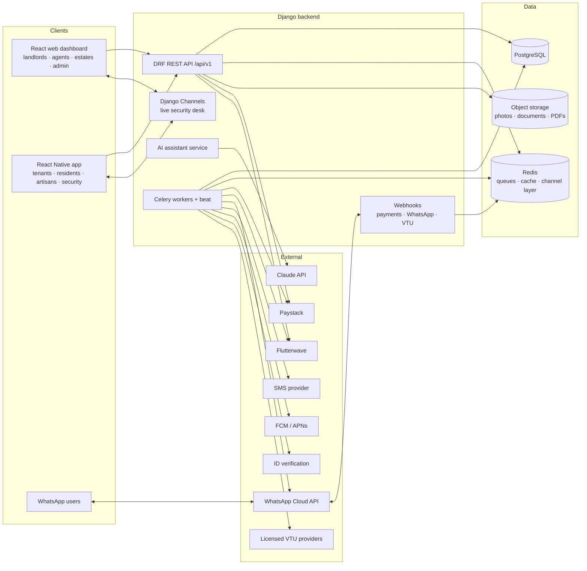

# Homesika: Architecture (Phase 0)

> Status: proposal for review. Nothing here is built yet beyond the skeletons and CI.
> Source of truth for scope: `docs/Homesika_Blueprint.docx` and the engineering brief.

## 1. System overview

One Django codebase serves the REST API, the webhooks and the WebSocket layer. Celery does all
slow or retryable work (reminders, alert fan-out, provider calls, AI jobs, reconciliation).
Clients never talk to third parties with secrets; the backend does.

## 2. Backend layout (Django apps)

| App | Responsibility | Phase |
|---|---|---|
| `core` | Base models (UUID, timestamps), money and encryption fields, error envelope, health checks, audit log | 0–1 |
| `accounts` | Users, phone OTP, login PIN, devices, consent records, data-subject requests | 1 |
| `orgs` | Organizations, memberships, roles and permissions (multi-tenancy) | 1 |
| `properties` | Estates, properties, units | 1 |
| `leasing` | Tenant profiles, leases, charges (rent, service charge, dues), arrears | 1 |
| `payments` | Gateways behind one interface, settlement subaccounts, payment links, webhooks, reconciliation, receipts | 1 |
| `expenses` | Expense log, monthly statements, exports | 1 |
| `notifications` | Push tokens, SMS, email, WhatsApp templates, delivery tracking, one `notify()` entry point | 1–2 |
| `messaging` | WhatsApp Cloud API adapter, conversations, messages, templates, opt-in | 2 |
| `listings` | Listings, leads, viewings, AI listing generator | 2 |
| `assistant` | Claude-backed assistant, knowledge base, tools, guardrails, usage caps, evaluation | 2 |
| `bills` | VTU providers behind one interface, failover, pay-per-transaction purchases, refunds | 3 |
| `maintenance` | Tickets, approvals, artisan assignment, ratings | 4 |
| `artisans` | Artisan profiles, verification (ID, phone, address, guarantors, references), badge | 4 |
| `estates` | Members, dues plans, announcements, gate passes | 5 |
| `security` | Panic alerts, fan-out, delivery tracking, incident and false-alarm logs, live desk | 5 |
| `analytics` | Event capture and success-metric queries | 1→6 |

Each app owns its models and exposes services (`services.py`) that views, tasks, WhatsApp
commands and assistant tools all call. **Business rules live in services, never in views**, so
the app, the web dashboard, WhatsApp and the assistant behave identically.

## 3. Multi-tenancy and roles

* **Tenancy unit = `Organization`**: a landlord's business, an agency, an estate association,
  or the platform itself. Every business record carries `organization_id` (directly or through
  its parent), and every query is scoped through it.
* **`Membership(user, organization, role)`** gives staff-type roles: `owner`, `manager`, `agent`,
  `accountant`, `estate_admin`, `security`, `viewer`.
* **Tenants and residents are not staff members.** They are linked by data, which keeps them
  from ever seeing an organization's other records:
  * a tenant is linked through `TenantProfile.user` → `Lease` → `Unit`;
  * a resident through `EstateMembership` (approved by the estate admin);
  * an artisan through a platform-verified `ArtisanProfile` plus specific job assignments.
* **Platform super-admin** is `User.is_staff` with explicit Django permissions, separate from
  org roles. All super-admin actions are audit-logged.
* **Enforcement, in three layers:**
  1. A tenancy-aware base queryset/manager plus DRF permission classes that require an org
     context and role for every staff endpoint.
  2. Object-level checks in services.
  3. Tests that try cross-tenant access on every endpoint (a reusable test helper runs
     "user from org B requests org A's object → 404").

  Postgres row-level security is a possible later hardening step, not a launch requirement.
* **Country and currency** are set per organization (default `NG`/`NGN`); amounts always travel
  with their currency.

## 4. Money rules

* **Storage:** integers in the currency's minor unit (kobo for NGN), `BigIntegerField`, plus an
  ISO currency code. Rounding is explicit and tested.
* **No stored wallet, escrow or held funds** until you confirm legal approval in writing.
  Concretely:
  * **Rent and dues** are paid through the gateway and **settle directly to the landlord's or
    estate's own bank account** via gateway subaccounts/split payments, with Homesika's fee split
    off at the gateway. Homesika never holds rent. ⚠ The exact split mechanics are
    `TODO(verify)` per gateway, and should also be confirmed in writing with Paystack (blueprint
    risk #1). See ADR-0002.
  * **Bills** are pay-per-transaction: the user pays the exact amount through the gateway, and
    then Homesika buys from the VTU provider from its own provider float. On final failure the
    payment is **refunded to source**, never credited to a balance.
* **Webhooks:**
  * signature-verified;
  * stored once, keyed by the provider's event id;
  * processed by Celery;
  * every payment is **re-verified by calling the gateway's API** before it counts.
* **Reconciliation:** a daily job compares gateway settlements and transactions against our
  records and flags mismatches for review.
* **Internal bookkeeping** (platform fees, the bills float, refunds) uses a small double-entry
  ledger reused from Goldia, without user wallet accounts.

## 5. Integrations behind interfaces

Every third party sits behind a Python protocol (interface), with:
* a real adapter;
* a **clearly labelled sandbox/mock adapter** (`*_mock.py`) for tests and local development;
* a registry that picks adapters from settings, giving failover order for gateways, VTU and SMS.

No adapter is "real" until it has been checked against the provider's official documentation;
unverified fields are marked `TODO(verify)` in code and listed in `docs/INTEGRATIONS.md`.

| Interface | Adapters (planned) | Failover |
|---|---|---|
| `PaymentGateway` | Paystack, Flutterwave, Mock | Yes, ordered per org/currency |
| `MessagingChannel` | WhatsApp Cloud API, Mock | n/a (SMS is a separate fallback) |
| `SmsProvider` | Termii (proposed), Mock | Optional second provider |
| `PushProvider` | Expo push or FCM/APNs directly (decision in Phase 1), Mock | n/a |
| `VtuProvider` | VTU.ng (reused from Goldia, licence to confirm), second provider TBD, Mock | Yes |
| `IdVerifier` | TBD (e.g. Prembly, Dojah, Smile ID, QoreID; your choice), Mock | n/a |
| `LlmClient` | Anthropic Claude (official `anthropic` Python SDK), Mock | Server-side refusal fallback |

## 6. The AI assistant (design summary; built in Phase 2)

* **One service, three surfaces:** the app chat, the web dashboard chat and WhatsApp all go
  through the same `assistant` service and the same guardrails.
* **Model:** Claude via the official Python SDK.
  * The default model is `claude-opus-5-5`, set by env var `ANTHROPIC_MODEL`.
  * Effort is set explicitly per route; low effort for chat keeps cost and latency down.
  * Switching high-volume routes (e.g. WhatsApp FAQ) to a cheaper model is **your call**, made
    after we measure quality on the evaluation set.
  * Server-side refusal fallback is enabled.
  * The API key is only in env (`ANTHROPIC_API_KEY`).
* **Grounding, with no invented facts:**
  * Every factual answer comes from tool results: the user's own data, read through the same
    permission-checked services the API uses, plus knowledge-base retrieval.
  * The knowledge base (FAQs, policies, how-tos, in English and Pidgin) lives in Postgres with
    full-text search to start; vector search (pgvector plus an embedding provider) only if
    evaluation shows full-text isn't good enough.
  * If no source supports an answer, the assistant says so and offers a human.
* **Tools:** read tools (my rent balance, my leases, listing search, ticket status, knowledge
  search) and action tools (create ticket, send reminder, generate listing, book viewing, start a
  bill purchase).
  * **Every action tool goes through a two-step confirm**: the model proposes, we show a
    confirmation card, and only the user's explicit "Yes" executes it.
  * Anything that spends or moves money also requires the transaction PIN in the app, or a
    payment link on WhatsApp.
  * Tools use strict JSON schemas and are executed server-side with the *user's* permissions,
    never broader ones.
* **Guardrails:**
  * Tool outputs and user content are treated as untrusted data (prompt-injection defence).
  * Operator instructions only go in the system prompt.
  * Per-user and per-org rate limits and monthly cost caps.
  * Output filters stop other users' personal data leaking.
  * Content moderation on inputs.
* **Escalation:** disputes, payment problems, safety emergencies and low-confidence answers
  create an `Escalation` for a human.
  * Emergencies: the assistant tells the user to contact police or emergency services (Nigeria:
    112) and offers to trigger the panic alert.
  * Homesika never claims to replace emergency services.
* **Logging and privacy:** every turn is logged (model, tokens, cost, tools, latency, guardrail
  flags), with retention limits, redaction of sensitive fields and user deletion on request.
* **Evaluation:** at least 100 realistic questions per role (≈700 total) with expected behaviour
  (answer from source / refuse / escalate / confirm-before-action). A script scores accuracy,
  correct refusals and escalations, and the release gate is a reported score.
* **Languages:** English and Nigerian Pidgin at launch; French later.

## 7. Security alert path (Phase 5, designed now because it shapes infra)

1. **Trigger:** hold-to-trigger in the app; silent mode suppresses sound and visible confirmation.
2. **Fan-out:**
   * The alert is written to the DB.
   * It goes to the live security desk at once over WebSocket, and to high-priority push for
     verified residents, security and the estate manager.
   * **SMS fallback** goes to anyone whose push isn't confirmed delivered or acknowledged within N
     seconds (configurable, e.g. 10–20 s).
3. **Tracking:** every delivery attempt is tracked (queued, sent, delivered, failed, plus latency);
   the desk marks the alert responding, resolved or false alarm.
4. **Abuse controls:** a rate limit per resident, a cancel window and a false-alarm log.
5. **Wording:** we never promise guaranteed delivery.

The fan-out Celery queue is dedicated and high priority, so reminders and AI jobs can never
delay an alert.

## 8. Cross-cutting

* **Auth:** phone number plus a one-time code (SMS, with email fallback), then a 6-digit login
  PIN on trusted devices, with short-lived JWTs. This is the proven Goldia flow. The web dashboard
  uses the same identity; whether staff also need a password or second factor is an open
  question.
* **Data protection (NDPA/NDPR):**
  * consent records per purpose;
  * minimal collection;
  * location only with explicit consent (panic alerts);
  * sensitive fields encrypted at rest with AES-256-GCM (IDs, bank details, next of kin);
  * export and delete requests handled by a workflow;
  * retention schedule.
* **Observability:**
  * structured JSON logs with request IDs;
  * Sentry for errors (DSN via env);
  * health endpoints `/health/live` and `/health/ready`;
  * Celery queue metrics;
  * alerting on failed jobs, webhook backlogs and payment/alert delivery failures.
* **Performance on weak networks:**
  * small paginated payloads and ETag/conditional GETs where useful;
  * image resizing on upload;
  * offline-tolerant mobile reads (cached queries) and queued writes for safe actions;
  * the panic button never depends on a slow screen load.
* **Analytics:** product events plus metric queries for the brief's success metrics (paying
  landlords and agents, rent volume, on-time rate, tickets resolved per week, alert delivery
  time, artisan repeat bookings, bills per active tenant, bill success rate, churn).

## 9. Environments

See `docs/ENVIRONMENTS.md`. There are three: local (Docker Compose), staging and production. The
same images run everywhere and all configuration comes from env vars.
